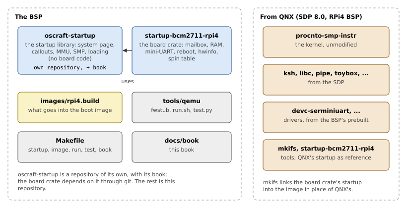

# Introduction

This chapter says what the BSP is, what is in it and what it uses from
QNX, and how the code and its two books are organized.

## A BSP, and its startup

A *board support package* is everything needed to run an operating system
on one board. For QNX, a BSP usually has:

- a **startup program**, which runs first from the boot image, describes
  the board to the kernel and starts it;
- **drivers** for the board's devices: serial ports, I2C and SPI buses,
  the SD card, the network, PCI Express;
- **build files** that say what goes into the boot image;
- notes on **booting** the board: firmware configuration, how to load the
  image;
- documentation.

The startup program is the part that everything else depends on: without
it nothing boots. QNX's own BSP for the Raspberry Pi 4 has a startup
written in C, on top of QNX's startup library, `libstartup.a`. This BSP
replaces it with one written in Rust, on top of a Rust startup library,
`oscraft-startup`. Its first goal is to boot QNX's unmodified kernel to a
shell, on all four cores; drivers in Rust may follow. Until they do, the
BSP uses QNX's prebuilt drivers.

The startup works with any kernel that implements QNX's startup contract.
That includes QNX's `procnto` and OsCraft's own kernel, which is binary
compatible with it; nothing in this BSP requires OsCraft's kernel.

## What is in the repository

Figure 1.1 shows the parts of the BSP and what comes from QNX. The
startup library is not in this repository: it has its own,
[oscraft-startup](https://github.com/capitan-davide/oscraft-startup), and
the board crate depends on it through git.

*Figure 1.1: The BSP's parts, and what comes from QNX.*

*Table 1.1: The repository.*

| Path | Contents |
|---|---|
| `startup-bcm2711-rpi4/` | The board crate: the Raspberry Pi 4's startup |
| `images/rpi4.build` | The build file of the boot image |
| `tools/qemu/` | Booting the image in QEMU, and testing it there |
| `tools/rpi4/` | Fetching the Raspberry Pi's device tree |
| `Makefile` | Building, running, testing, the books |
| `docs/book/` | This book |

## Two crates, two books

The startup code is split in two crates, the way QNX splits it between
`libstartup.a` and a board's directory:

- **`oscraft-startup`** has everything that does not depend on the board:
  the system page, the callout framework, the page tables, loading the
  kernel, starting the CPUs, the GICv2 interrupt controller, the AArch64
  CPU and timer. It has no board code at all.
- **`startup-bcm2711-rpi4`** has what only this board needs: talking to
  the GPU's firmware for the RAM layout, the mini-UART, the spin table that
  holds the other cores, the watchdog that resets the board, the devices
  the drivers look for. Its `main()` calls the library in order.

The library lives in a repository of its own, so that other boards can
use it, with its tests and its own book, which describes the library
without board code (it uses boards only as examples). This book covers
the rest, and refers to the library's book for the library; `make book`
builds the two side by side (Chapter 2).

## What comes from QNX

The BSP builds images from QNX's SDP 8.0, which has to be installed and
licensed separately:

- the kernel, `procnto-smp-instr`, and the programs and libraries of the
  boot image (`ksh`, `libc.so`, `pipe`, `toybox`, ...);
- `mkifs`, which builds the image, and the SDP's compiler, which checks
  the library's binary interface against QNX's headers;
- QNX's Raspberry Pi 4 BSP package, for its prebuilt drivers (the serial
  driver for the console) and for its startup, which serves as the
  reference that this startup is compared against (Chapter 9).

The repository contains none of these. Nor does it depend on where they
are installed: the build takes them from the SDP's environment (Chapter
2).
