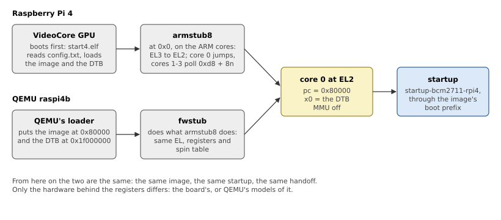

# How the Raspberry Pi 4 Boots

On most boards the CPU starts first and runs a boot loader. On the
Raspberry Pi, the GPU starts first, and it decides what the ARM cores run.
This chapter follows the Raspberry Pi 4's boot up to startup's first
instruction, and shows how QEMU is made to boot the same way.

## The GPU boots the ARM

The BCM2711 has a VideoCore VI GPU and four Cortex-A72 cores. At power-on,
only the GPU runs. Its boot ROM loads the second-stage boot loader from an
EEPROM, which finds the SD card and loads the GPU's firmware,
`start4.elf`. The firmware reads `config.txt` to learn what to do. QNX's
BSP documentation gives this one:

```text
[rpi4]
arm_64bit=1
force_turbo=1
enable_uart=1
gpu_mem=16
max_framebuffers=2
kernel=ifs-rpi4.bin
```

- `arm_64bit=1` starts the ARM cores in AArch64;
- `kernel=` names the file to load, the boot image, which the firmware
  loads at 0x80000, the address the build file gives (`[image=0x80000]`);
- `enable_uart=1` sets the mini-UART up on GPIO 14 and 15, at a fixed core
  clock, and `force_turbo=1` keeps the clocks from changing under it;
- `gpu_mem=16` gives the GPU 16 MB of the RAM; the rest is the ARM's.

The firmware also loads the board's device tree, `bcm2711-rpi-4-b.dtb`,
and edits it (the RAM size, the MAC address, the command line) before it
starts the ARM.

## armstub8

The ARM cores start at physical address 0, in EL3, where the firmware has
put a small program, *armstub8*. On each core it sets up EL3, gives the
GIC's interrupts to the non-secure world, and drops to non-secure EL2.
Then:

- core 0 jumps to the image, at 0x80000, with `x0` holding the device
  tree's address;
- cores 1 to 3 wait, in a loop with `wfe`, until the 64-bit word at
  `0xd8 + 8 × core` holds an address, and jump there with `x0` = 0. This
  is the *spin table*; the device tree gives the words' addresses as each
  CPU's `cpu-release-addr`.

Figure 3.1 shows the sequence, and its QEMU counterpart.



*Figure 3.1: From power-on to startup, on the board and in QEMU.*

So startup can count on this: core 0 at EL2, MMU off, `x0` the device
tree, and three cores waiting on the spin table in the first page of RAM.
The first page must survive until the other cores have left it, which is
why the board crate keeps it out of RAM (Chapter 5).

## The same boot in QEMU

QEMU's `raspi4b` machine models the BCM2711's peripherals, but not the
GPU's boot: given an ELF file with `-kernel`, it starts every core at its
entry point in EL3, with nothing in `x0`. To boot the same image as the
board, `tools/qemu/fwstub/fwstub.S` does armstub8's job (Listing 3.1),
and QEMU's loader device puts the image at 0x80000 and the device tree at
0x1f000000 (Listing 2.3).

*Listing 3.1: The firmware stub's handoff, at EL2 (`tools/qemu/fwstub/fwstub.S`).*

```text
{{#include ../../../tools/qemu/fwstub/fwstub.S:fwstub_el2}}
```

The stub is linked at address 0 and occupies the first page, like
armstub8, with the spin table at the same address. Before the code
above, at EL3, it gives the GIC's interrupts to the non-secure world when
the GIC has security extensions (QEMU's does not) and drops to EL2.

The device tree is the Raspberry Pi firmware's own, downloaded from a
pinned release and checked against its SHA-256 by
`tools/rpi4/fetch-firmware.sh`. Unlike the real firmware, QEMU does not
edit it; QEMU's mailbox answers the questions that matter (Chapter 5).

> [!NOTE]
> With the firmware stub, the same image boots on the board and in QEMU,
> with the same startup options (`-u reg`: the device tree's address is in
> `x0`). An image started by U-Boot's `go` command gets the device tree's
> address as an argument instead, and takes `-u arg`, as with QNX's
> startup.
